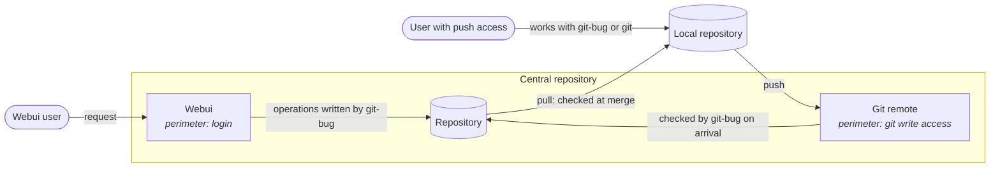
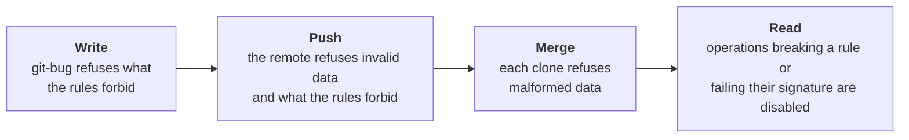

# Threat model

This document describes who git-bug trusts, what it guarantees, and which threats are handled or accepted.

Parts of this model are not implemented yet: [Current state](#current-state) says what holds today.

## In short

git-bug stores its data in a git repository. It guarantees **convergence**, **integrity** and **attribution** of that data, and leaves enforcement to **whoever controls write access**. This is the position of git itself: the data is verifiable, the policy is applied where the data enters.

A central repository has two ways in, each with its own perimeter:

- **The webui**, behind the login of the git-bug instance. git-bug writes the operations itself, so its users can only do what it accepts.
- **The git remote**, behind git write access. What is pushed was written elsewhere, and git-bug checks it on arrival: either git-bug serves the remote itself, or a server-side hook runs its checks.

On a plain git host, where neither is possible, a push is not checked, and whoever has write access is trusted like a maintainer.

## Guarantees

| Property | Meaning |
|---|---|
| Convergence | clones holding the same commits, config and Identities included, and knowing the same rules, compute the same state, whatever the order they received them in. A client older than a rule of the config does not apply it, and is told to upgrade |
| Integrity | history can't be altered without changing its hashes, as for any git data |
| Attribution | an operation signed with the keys of an Identity was made by it. An Identity may start without keys: its operations are then attributed on trust. A repository can require signed commits through its config |

What git-bug does not guarantee:

- **Confidentiality.** Everything in the repository, including the email of an Identity, is readable by anyone who can read the repository. Hiding content only affects display. Who may read a repository is decided by where it is hosted, outside this model.
- **Trustworthy time.** When an operation was made is claimed by its author, both its wall-clock date and its logical time. Ordering never relies on the date. Rules are judged by the logical time, so a pusher can make an operation look older than a rule and escape it.

The security of the web application itself (sessions, request forgery, rendering of user content, resource limits) is a separate matter, not covered here.

## Actors

| Actor | Access | Trust |
|---|---|---|
| Reader | reads the repository or the webui | none needed |
| Webui user | logged in on a git-bug instance, which writes on their behalf | untrusted: can only do what the instance accepts |
| Pusher | git write access to the remote | checked on arrival, trusted for what that check cannot see; on a plain git host, trusted like a maintainer |
| Instance operator | runs a git-bug instance and holds its key | trusted: the instance signs for its users |
| Git host operator | controls the references | trusted for availability, and for the check of pushes when it runs as a server-side hook on its host; can't forge signed data |
| Outdated client | an honest pusher with an older git-bug | honest, but unaware of newer rules |
| Thief | holds a stolen push credential, signing key, or both | the adversary that remains |

## Where data enters, and where it is checked

| Entry point | Who | What checks the data |
|---|---|---|
| Webui and API | webui users | the instance, which builds the operations itself: author, ordering and rules are under its control |
| `git push` | pushers | git-bug on arrival, serving the remote itself or through a server-side hook; nothing on a plain git host |
| Pull from a remote | each clone | the merge, which refuses malformed data |
| Bridges | a pusher or the instance operator, whoever runs the import | the importer, writing on behalf of the external accounts |

A push carries operations that git-bug didn't write: they may come from an older version, another tool, or a pull from somewhere else. On arrival, git-bug can check what the data shows (its structure, its signatures, the rules of the config), but not what the author claims: when an operation was made, or what its author had seen. That part rests on the trust given to whoever has write access.

The remote also knows what is new to it and its own current state, which no clone can tell. It refuses a commit signed with a key that is revoked when it arrives, and a rule or key change recording clocks behind its own.

Pulling is an entry point too. A clone that pulls from an untrusted remote and then pushes carries that data inside the perimeter: the remotes a pusher pulls from are part of what is trusted.

An operation meets four checks in its life:

The first two depend on where the operation comes from: it may be written with another tool, and pushed to a plain git host. The last two are made by every clone, on its own, with the same verdict.

## Design consequences

1. **Write access is the trust boundary.** The data is checked where it enters, and nothing in its format tries to prove what an author with write access claims.
2. **Rules are enforced at write time, and applied again at read time.** An operation that doesn't conform to the rules is disabled when reading: it stays in the data, has no effect, and the entity stays readable. That it was disabled, and why, is recorded for tools to show. An operation is judged by the config as it was when the operation was made, so a new rule leaves earlier operations alone.
3. **Only the format of the data is a hard gate.** Malformed data is refused by every clone, along with its entity. Everything that depends on another entity is not: an operation whose signature does not verify is disabled like one breaking a rule, and its entity stays readable.
4. **Rules are refused at the entry wherever git-bug checks it**: always for webui users, and for pushers when the remote checks what arrives. On a plain git host, an operation breaking a rule enters the repository, and is disabled when reading.

## Threats

| Threat | Needs | Outcome |
|---|---|---|
| Writing operations under the name of an Identity with keys | push access | refused on arrival; on a plain git host, disabled when reading: the signature does not verify |
| Writing operations under the name of an Identity without keys | push access | takes effect, unless the config requires signed commits: the operation is then disabled |
| Changing someone else's Identity, to add a key or break their history | push access | refused for an Identity with keys, which only accepts versions signed by them. An Identity without keys can be changed by any pusher |
| Operation breaking a rule of the config | push access | refused on arrival; on a plain git host, disabled when reading |
| Operation made to look older, to be judged by an earlier config | push access | takes effect. Accepted: a pusher is trusted |
| Config or key change recording clocks behind the remote, on purpose or from an out-of-date clone, so that existing operations become disabled | push access | refused on arrival: the remote knows its own clocks, and the author synchronises and retries. On a plain git host it takes effect, and nothing is lost: correcting the config brings the operations back, and operations signed with a replaced key can be made again with the new one |
| Operation signed with a stolen key that is still valid | stolen key and push credential | indistinguishable from a real one until the key and the credential are revoked. Inherent to signatures |
| Operation signed with a stolen key that was since replaced, made to look older than the replacement | stolen key and push credential | refused on arrival: the key is revoked when the push arrives. On a plain git host it takes effect, and ends with the credential |
| Outdated client pushing what a newer rule forbids | push access | refused on arrival; on a plain git host, disabled when reading. The client is told to upgrade when it meets a config it does not fully know |
| Pulling the config of another project, from a wrong or hostile remote | pulling from it | reported as a conflict, nothing is merged |
| Instance writing in the name of its users | operating the instance | by design. A user holding their own keys keeps exclusive authority over their signature |
| Deleting or rewinding references on the remote | push access and a forced push, which git-bug never makes, or the host | refused on arrival; on a plain git host, or by the host itself, it takes effect. Every clone keeps the data, and its next push brings it back |
| Import attributing content to the wrong Identity, or importing what the external tracker never held | running a bridge | takes effect. What the external tracker says is taken as true, and whoever runs the import is trusted like a pusher |

### Denial of service

A pusher can degrade a repository without forging anything:

- **Clock inflation**: a commit claiming a far-ahead logical time pulls the clock of every clone forward.
- **Unreadable entities**: a single malformed commit makes its entity unreadable. Such an entity is refused at merge, so the damage stays on the remote, and the other entities stay usable.
- **Volume**: nothing limits the number or the size of entities.

Where pushes are checked, the first two are refused on arrival. On a plain git host they are accepted from pushers.

## Dealing with a misbehaving identity

The answer has three parts, none of which makes data unreadable:

- **Stop new writes**: the instance refuses the identity, and the git host removes its push access if it has one.
- **Hide what is there**: a filter applied when reading, driven by the config. Every clone with the same config hides the same content, nothing is deleted, and the filter can be lifted. It can cover everything the identity wrote, or only what it wrote from a point in time.
- **Hide a single item**: one bug or one comment.

Creating an identity is free for a pusher, so stopping one doesn't stop the person. For a webui user, an identity is tied to their external account.

## Outside this model

**Peer-to-peer exchange.** Where operations are exchanged without a remote deciding who may write, the perimeter this model relies on doesn't exist. Rules would have to be decided by the data alone, which requires recording which operations each author had seen, and a way to establish that an operation existed before a rule or a key change. Nothing in this model closes that path.

**Encrypted content.** Content that only some users may read would have to be encrypted. Confidentiality brings threats of its own, not covered here: removing a reader only protects what is written after, a leaked key exposes everything written under it, and metadata stays visible.

## Current state

Convergence and integrity hold today, and so do these parts of the model:

- the merge refuses malformed data per entity, and the other entities merge normally;
- pulling the config of another project is reported as a conflict;
- git-bug never forces a push.

The rest is in progress:

- **Signing.** Identities can hold keys, but nothing creates them and Identity versions aren't signed: every operation is attributed on trust.
- **Disabling operations.** What should disable an operation makes its whole entity unreadable instead: a signature that doesn't verify, or an author Identity that can't be read.
- **Checks of pushes.** git-bug neither serves a remote nor provides a server-side hook: every remote is a plain git host.
- **Webui login.** The webui has no login, and writes as the single user it was started with. Whoever can reach a writable webui acts as that user, so it should not be exposed beyond a trusted network. `--read-only` serves it without writes.
- **Config rules.** The config holds labels and repository settings, with no rules yet: no required signatures, no hiding, no upgrade notice for older clients.

Until then, read this model with every remote as a plain git host, every Identity without keys, every webui user as the single user of the instance, and no rules. In the threats above, this leaves the outcomes for an Identity without keys, the operations a pusher makes look older, the rewinding of references, imports and denial of service from pushers. A misbehaving identity is stopped only by removing its push access.
